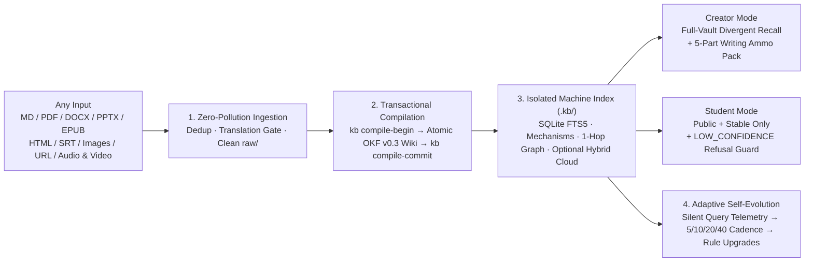

# Personal OKF-Wiki

**A Local-First, Self-Evolving AI Personal Knowledge Base Engine**

[](#quick-start)
[](#quick-start)
[](#architecture)
[](#agent-skill-integration)
[](#license)

> Turn scattered books, articles, PDFs, notes, images, subtitles, web pages, and audio/video recordings into a **clean, human-readable Obsidian wiki and a 95+ precision AI retrieval engine** — running **100% locally with zero external APIs**, safe for multi-agent concurrent collaboration, and equipped with scientific viral-content deconstruction and evidence-driven self-evolution.

---

## Why Personal OKF-Wiki?

Most AI note-taking setups and personal RAG scripts break down after the first 50 documents:

1. **Vector-only RAG black boxes** bury your knowledge inside opaque chunks, lose document lineage, hallucinate when confidence is low, and degrade when your vault grows.
2. **Naive AI-edited Obsidian vaults** pollute human-readable Markdown with hashes and metadata clutter, silently overwrite your handwritten notes, break links on rename, and corrupt state when two agents edit at once.
3. **Static prompts never improve** — they repeat the same retrieval blind spots and ingest low-signal viral posts without separating real psychological mechanisms from luck or account size.

**Personal OKF-Wiki** combines **Karpathy's LLM Wiki pattern**, **Google OKF v0.3 atomic knowledge schema**, **Obsidian-native Markdown**, and a **deterministic Python transaction engine (`kb`)** into one cohesive system:

| Capability | Plain Obsidian Vault | Typical Local RAG Script | **Personal OKF-Wiki** |
|---|:---:|:---:|:---:|
| Pure human-readable Markdown (zero hash pollution) | Yes | — | **Enforced (`.kb/` isolated)** |
| Zero-API offline high-precision retrieval (95+ score) | Keyword only | Requires embeddings | **Built-in FTS5 + 1-hop Graph** |
| Optional hybrid cloud upgrade (98+ Embedding + Rerank) | — | Custom wiring | **Pluggable via `.kb/.env`** |
| Transactional multi-agent collaboration + crash recovery | — | — | **Git + SQLite WAL + 4 Locks** |
| Creator vs. Student dual-mode retrieval & refusal guard | — | — | **Built-in (`--mode`)** |
| Scientific viral content attribution & template extraction | — | — | **Built-in (`kb-viral-ingest`)** |
| Telemetry-driven self-evolution with `model_ceiling` brake | — | — | **Built-in (`kb-evolve`)** |

---

## Architecture



---

## Core Value & Engineering Pillars

### 1. Physical Human–Machine Isolation (Zero Pollution in Reading Zones)
- `inbox/`, `raw/`, and `wiki/` stay **100% pure, human-readable Markdown** with standard relative links that preview natively in Obsidian (no `[[wikilink]]` lock-in, no ugly hash strings in prose).
- All machine state — SQLite FTS5 index, content hashes, query telemetry, write locks, and `.env` secrets — lives strictly inside `.kb/`.

### 2. Transactional Multi-Agent Safety & Four Hard Locks
- **Git + SQLite WAL Reconciliation**: `kb compile-begin` snapshots human edits cleanly before locking a compile batch; `kb compile-commit` runs full validation, rebuilds indexes, and commits atomically; `kb recover` reconciles interrupted sessions with zero data loss.
- **Four Built-In Safety Locks**:
  1. **Human Immutable Zone Lock**: Never modifies a single byte between `<!-- human:start -->` and `<!-- human:end -->`.
  2. **Verified Page Append-Only Lock**: Pages marked `verified` only permit non-destructive appends at the bottom.
  3. **Anti-Deletion & Anti-Shrinkage Locks**: Blocks accidental content truncation or page loss during AI compilation.
  4. **Poison-Pill Isolation (`kb compile-fail`)**: Quarantines a single corrupted source without blocking the rest of the batch.

### 3. Dual-Mode Precision Retrieval (95+ Offline, 98+ Plug-in Hybrid Cloud)
- **Creator Mode (`--mode creator`)**: Designed for writing, research, and synthesis. Runs full-vault divergent search with paragraph/page AND-priority FTS5, `mechanisms` underlying-principle indexing, Top-K 1-hop graph expansion (strictly separating `confirmed_relations` from `candidate_relations`), and gentle firsthand-experience weighting.
- **Student Mode (`--mode student`)**: Designed for trustworthy Q&A. Strictly restricts retrieval to `visibility: public` + `status: stable`, prioritizes `verified` pages, and triggers an explicit `LOW_CONFIDENCE` refusal guard instead of hallucinating.
- **Pluggable Cloud Hybrid Upgrade (`v3.1.2`)**: Works 100% offline by default. To boost precision from ~95 to 98+, drop an API key (OpenAI-compatible, Gemini, or SiliconFlow free tier `BAAI/bge-m3` + `BAAI/bge-reranker-v2-m3`) into `.kb/.env` (gitignored) and run `kb rebuild`. Built-in health checks proactively warn you if cloud retrieval ever degrades back to local mode.

### 4. Universal Multimodal Ingestion & Quality Gates (`v3.1.0–3.1.1`)
- **Zero-Dependency Native Adapters**: `.md`, `.txt`, `.srt`, `.vtt`, `.html`, `.pdf` (macOS PDFKit), `.docx`, `.pptx`, `.epub`, `.csv`, `.png`/`.jpg`/`.webp`/`.heic` (auto-converted to JPEG for vision models), `.webloc`/`.url`/`.link` bookmarks, and `kb add --url`.
- **Pluggable Audio & Video Transcription**: `.mp3`, `.m4a`, `.wav`, `.ogg`, `.flac`, `.aac`, `.mp4`, `.mov`, `.mkv`, `.webm` (`ffmpeg` audio extraction → cloud Whisper / SenseVoice → clean transcript into `raw/`, keeping Git lightweight). Run `kb adapters --json` to inspect adapter readiness.
- **Dual Ingestion Gates**: Automatically deduplicates across `raw/` and `wiki/sources/` before ingestion, and enforces faithful localization of foreign-language sources with bilingual terminology preservation.

### 5. Scientific Viral Content Deconstruction (`kb-viral-ingest`)
- Separates text mechanics from non-textual confounders (account authority, traffic spikes, trending news).
- Performs metric-specific causal attribution grounded in behavioral economics, cognitive psychology, social psychology, and narratology — backed by counterfactual tests, minimal-diff negative-sample comparisons, and domain-agnostic reusable skeletons.

### 6. Evidence-Driven Adaptive Self-Evolution (`kb-evolve`)
- Silently captures real query telemetry (zero-hit rates, latency, fallback patterns) and triggers diagnostic reviews on an adaptive backoff cadence (`5 → 10 → 20 → 40` ingested documents).
- **Honest `model_ceiling` Brake**: Automatically hibernates evolution when hitting current architecture/model limits instead of churning rules blindly, waking up only when corpus growth or zero-hit pain warrants refinement — and evolves *future rules* without forcing disruptive rewrites of historical pages.

---

## Quick Start

```bash
# 1. Clone and install the deterministic local engine
git clone https://github.com/aidenlychen-debug/personal-okf-wiki.git
cd personal-okf-wiki
python3 -m venv .venv
.venv/bin/pip install -e .

# 2. Idempotently initialize directory layout, SQLite FTS5 DB, and Git repo
.venv/bin/kb init

# 3. Verify vault health and adapter readiness
.venv/bin/kb status --json
.venv/bin/kb adapters --json
```

### Optional: Enable 98+ Cloud Hybrid Retrieval (`.kb/.env`)

```bash
cat <<'EOF' > .kb/.env
KB_EMBEDDING_API_KEY="your_api_key_here"
KB_RERANK_API_KEY="your_api_key_here"
EOF
chmod 600 .kb/.env
.venv/bin/kb rebuild --json
```

*(`.kb/.env` is automatically loaded on every CLI invocation and excluded via `.gitignore`.)*

---

## Agent Skill Integration

Mount this repository directly in **Claude Code, Cursor, Gemini / Antigravity, or Codex**. The root [`SKILL.md`](./SKILL.md) and [`AGENTS.md`](./AGENTS.md) route agents to five specialized modular workflows:

| Workflow | Skill Spec | Primary CLI Pipeline |
|---|---|---|
| **General Knowledge Ingestion** | [`skills/kb-ingest/SKILL.md`](./skills/kb-ingest/SKILL.md) | `kb scan` / `kb add` → `kb compile-begin` → `kb compile-commit` |
| **Scientific Viral Deconstruction** | [`skills/kb-viral-ingest/SKILL.md`](./skills/kb-viral-ingest/SKILL.md) | `kb query` (contrast) → causal attribution & skeleton → `kb compile-commit` |
| **Dual-Mode Retrieval & Writing Pack** | [`skills/kb-query/SKILL.md`](./skills/kb-query/SKILL.md) | `kb query "<topic>" --mode creator\|student --json` |
| **Governance, Audit & Refactoring** | [`skills/kb-lint/SKILL.md`](./skills/kb-lint/SKILL.md) | `kb lint` / `kb audit` / `kb refactor rename\|merge` |
| **Adaptive Self-Evolution** | [`skills/kb-evolve/SKILL.md`](./skills/kb-evolve/SKILL.md) | `kb evolve-report` → evidence review → `kb evolve-mark` |

---

## CLI Cheat Sheet

All commands support `--json` with a strict machine contract (`{"ok": true, ...}` / `{"ok": false, "error_code": "...", ...}`):

```bash
# Ingest & Transactional Compile
kb scan --json                                             # Scan inbox/ across all supported formats
kb add --text "<clean text>" --title "<title>" --json      # Capture quick insight or note
kb add --url "https://..." --title "<title>" --json        # Fetch web article as clean Markdown
kb compile-begin --limit 10 --json                         # Snapshot human edits & lock compile batch
kb compile-commit --session <id> --note "<summary>" --json # Validate locks, reindex & commit atomically
kb recover --json                                          # Zero-loss crash recovery across Git + SQLite

# Lock-Free Concurrent Queries
kb query "<keywords>" --mode creator --json                # Full-vault creator retrieval
kb query "<keywords>" --mode student --json                # Public + stable + verified Q&A mode

# Governance & Maintenance
kb lint --json                                             # Validate OKF v0.3 schema, relative links & locks
kb audit --json                                            # Readiness, orphan, deprecated & dedup audit
kb refactor rename concepts/old.md concepts/new.md --json  # Atomic link-safe rename
kb refactor merge concepts/dup.md concepts/main.md --json  # Atomic link-safe merge
kb evolve-report --json                                    # Telemetry diagnostics & delta metrics
kb rebuild --json                                          # Lossless rebuild of .kb/kb.db from raw/ + wiki/
```

---

## Repository Structure

```text
personal-okf-wiki/
├── SKILL.md                  # Unified Agent Skill entrypoint & CLI routing
├── AGENTS.md                 # Multi-agent collaboration constitution & engineering invariants
├── config.yaml               # Retrieval weights, safety locks, adapters, cloud API & evolution config
├── pyproject.toml            # Python package metadata & `kb` CLI entrypoint
├── src/kb_engine/            # Deterministic core engine (SQLite FTS5, graph, WAL transactions, evolution)
│   └── adapters/             # Multimodal format decoders (PDF, Office, EPUB, HTML, Images, URL, Media)
├── skills/                   # 5 modular domain Agent Skills (ingest, viral-ingest, query, lint, evolve)
├── docs/                     # Obsidian integration guide (docs/obsidian-setup.md)
├── scripts/                  # Baseline reset helper (reset-to-baseline.sh)
├── inbox/                    # Raw dropbox for incoming materials (created by `kb init`)
├── raw/                      # Immutable cleaned source archive (created by `kb init`)
└── wiki/                     # Compiled OKF v0.3 atomic knowledge base (sources/concepts/cases/evidences/insights)
```

---

## License

**Free for Personal & Non-Commercial Use; Commercial Use Requires Prior Written Authorization.**

- **Personal / Non-Commercial Use**: Individuals may freely use, copy, study, and modify this software, documentation, and bundled Agent Skills for personal learning and non-commercial purposes (retaining the copyright and license notice).
- **Commercial Use**: Any commercial usage — including paid services/SaaS, paid student/customer Q&A systems, bundling into paid courses/communities, or internal commercial deployment by companies/teams — requires **prior written authorization** from the author. See [LICENSE](./LICENSE) for full legal terms.
